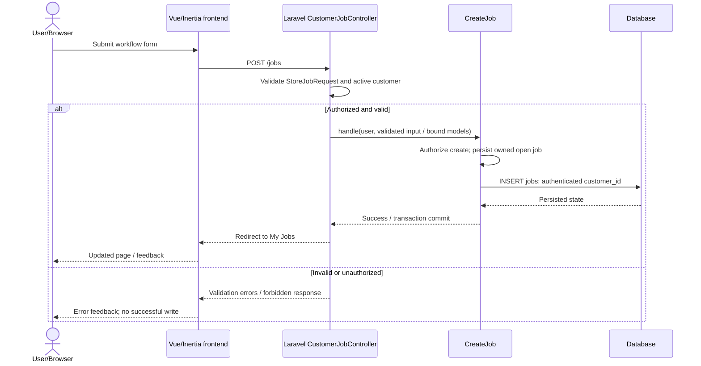
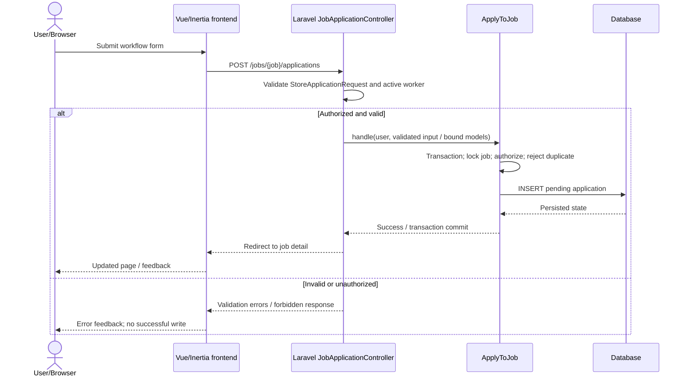
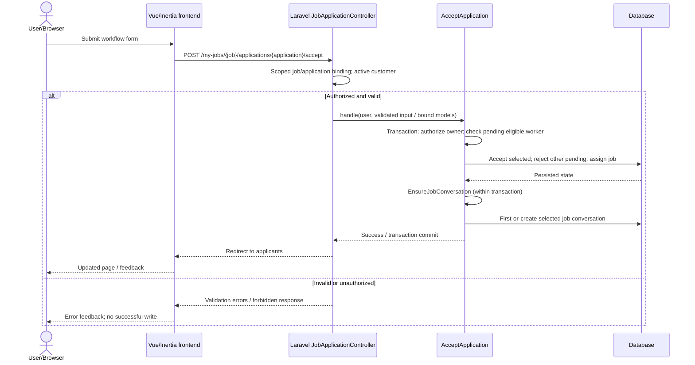
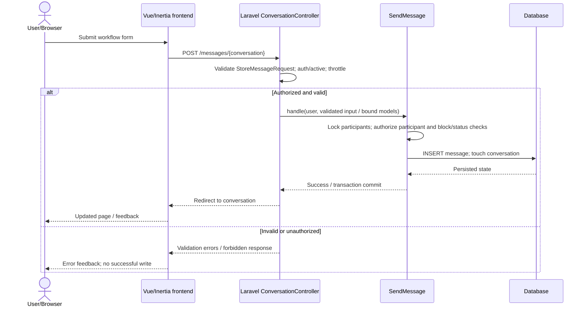
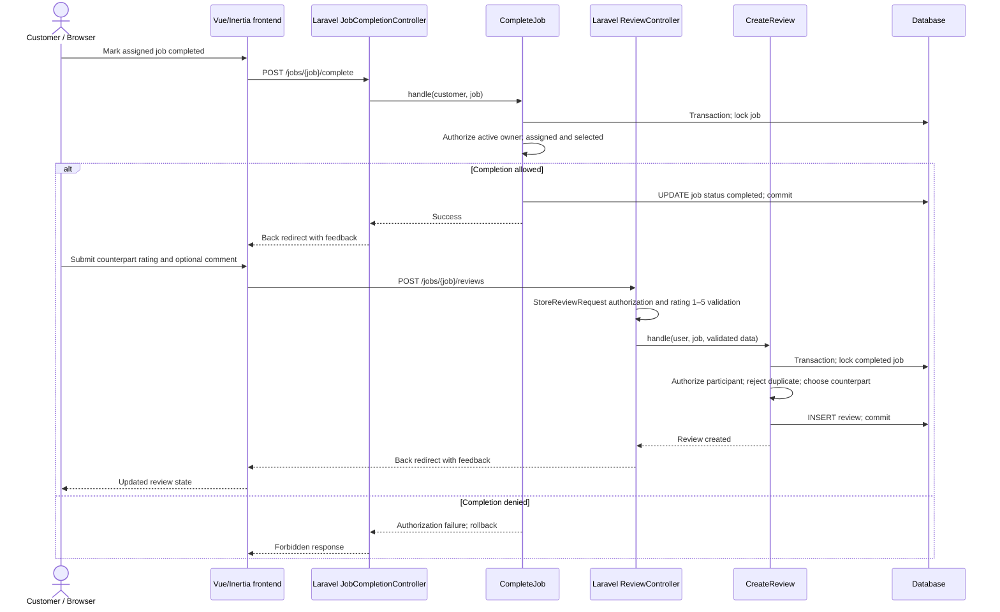

# Sequence Diagrams

Status: models of inspected existing code, not observed runtime results. Routes, Form Requests, controllers, Action classes and Eloquent persistence determine these flows. Vue/Inertia submits requests and receives redirect-driven updated page props. Rejection paths stop writes; no realtime transport is claimed.

## Customer posts a job

Action-level state or authorization failures also abort/roll back and return an error. Evidence: [CustomerJobController](../../app/Http/Controllers/CustomerJobController.php), [CreateJob](../../app/Actions/CreateJob.php).

## Worker applies for a job

Action-level state or authorization failures also abort/roll back and return an error. Evidence: [JobApplicationController](../../app/Http/Controllers/JobApplicationController.php), [ApplyToJob](../../app/Actions/ApplyToJob.php).

## Customer selects a worker

Action-level state or authorization failures also abort/roll back and return an error. Evidence: [JobApplicationController](../../app/Http/Controllers/JobApplicationController.php), [AcceptApplication](../../app/Actions/AcceptApplication.php).

## Customer and worker send messages

Action-level state or authorization failures also abort/roll back and return an error. Evidence: [ConversationController](../../app/Http/Controllers/ConversationController.php), [SendMessage](../../app/Actions/SendMessage.php).

## Customer completes job and participant reviews

The selected worker may separately review the customer after completion; the worker cannot mark the job completed. Invalid ratings, nonparticipants, premature or duplicate reviews are rejected before persistence. Sources: [CompleteJob](../../app/Actions/CompleteJob.php), [CreateReview](../../app/Actions/CreateReview.php), [StoreReviewRequest](../../app/Http/Requests/StoreReviewRequest.php). Controllers redirect; the updated Inertia page is loaded through the ensuing request.
