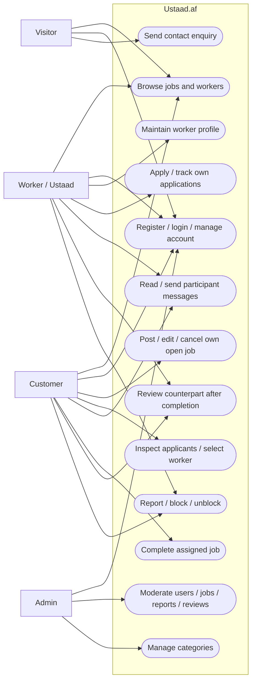

# Use Case Diagram

Status: IMPLEMENTED code baseline; model prepared for verification. Mermaid flowchart provides a use-case-style view; it is not strict UML actor notation.

Visitors discover jobs/workers, register/login and contact the platform. Customers manage their own open jobs, inspect applicants, select one worker, communicate and complete assigned work. Workers manage profiles, apply, track applications and communicate after selection. Both participants can review after completion and use reporting/blocking. Admins moderate users, jobs, reports/reviews and maintain categories. Public browsing remains available without authentication.

Role/status middleware and policies constrain use cases: active account and correct ownership/participation are required; public signup cannot grant admin. Reviews require completion; conversations relate to accepted applications. Admin is an existing role, not an additional Scrum team member. [Source routes](../../routes/web.php) · [requirements](../03-requirements/functional-requirements.md).
