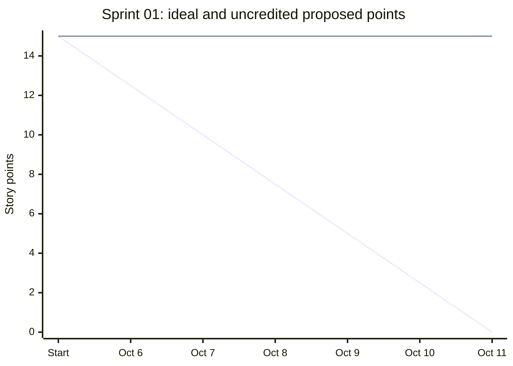

# Sprint 01 Burndown

Project: **Ustaad.af - Digital Marketplace for Skilled Workers**

Dates: **October 6-11, 2026** (6 scheduled calendar workdays).

Sprint goal: Verify requirements, architecture, public discovery, authentication and worker profiles; establish Scrum documentation.

## Baseline and evidence basis

The [sprint backlog](../06-sprints/sprint-01/sprint-backlog.md) proposes **15 story points**. The [planning record](../07-meetings/sprint-planning/2026-10-06-sprint-planning.md) retains the proposal without establishing individual availability or a final capacity-backed commitment. **Final committed total is not established in the project records.** The proposed total supplies the chart baseline.

Daily records describe intended checks and scripted actions, not measured end-of-day balances. The [review record](../07-meetings/sprint-review/2026-10-11-sprint-review.md) leaves all five stories pending verification and records no accepted story. Therefore **0 points are credited as Done and 15 proposed points remain uncredited** in this reconciliation. This records documented acceptance; it does not claim that no work occurred.

## Story-point reconciliation

| Story | Proposed scope | Proposed points | Credited Done points | Uncredited points |
| --- | --- | ---: | ---: | ---: |
| US-01 | browse and filter public jobs | 3 | 0 | 3 |
| US-02 | discover workers and view public profiles | 3 | 0 | 3 |
| US-03 | register as a customer or worker | 3 | 0 | 3 |
| US-04 | log in and manage account credentials | 3 | 0 | 3 |
| US-05 | maintain my skills and worker profile | 3 | 0 | 3 |
| **Total** | **Five stories pending verification** | **15** | **0** | **15** |

Credit requires the [Definition of Done](../06-sprints/sprint-01/definition-of-done.md), including supporting verification and Bahara Noorzai's acceptance. Existing implementation, test-file presence, planned checks and partial functionality do not earn story points. Sahar Haidary owns technical evidence; Bahara owns acceptance; Ahmad maintains progress records.

## Daily burndown

Start-of-sprint ideal: **15 points**. For scheduled day d, ideal remaining = max(0, 15 * (1 - d / 6)), rounded to two decimals. All scheduled dates count, including weekends, matching the daily sprint schedule.

Uncredited proposed points = 15 minus documented accepted points. This reconstructed balance stays at 15 because the sources supply no dated Done decision. **Actual daily remaining-effort measurements are absent.** These balances must not be labeled measured actuals. Each date links to its stand-up; the final date also uses the review cited above.

| Date | Ideal remaining points | Uncredited proposed points | Recorded focus and evidence status |
| --- | ---: | ---: | --- |
| [2026-10-06](../07-meetings/daily-standups/2026-10-06-daily-standup.md) | 12.50 | 15 | Provisional scope and availability; map discovery/account criteria to tests. |
| [2026-10-07](../07-meetings/daily-standups/2026-10-07-daily-standup.md) | 10.00 | 15 | Plan combined filters, pagination, public-profile privacy and registration checks. |
| [2026-10-08](../07-meetings/daily-standups/2026-10-08-daily-standup.md) | 7.50 | 15 | Prioritize role injection, unauthorized edits, suspended accounts and invalid inputs. |
| [2026-10-09](../07-meetings/daily-standups/2026-10-09-daily-standup.md) | 5.00 | 15 | Separate confirmed defects, unexecuted checks and missing setup; retain points until Done. |
| [2026-10-10](../07-meetings/daily-standups/2026-10-10-daily-standup.md) | 2.50 | 15 | Prepare evidence and UML comparison; missing verification prevents acceptance. |
| [2026-10-11](../07-meetings/daily-standups/2026-10-11-daily-standup.md) | 0.00 | 15 | Review retains all five stories pending verification; compare carry-over with Sprint 2 priorities. |

## Burndown chart

First line: ideal remaining points. Second line: uncredited proposed points reconstructed from the records. Start is the baseline before the first workday. The table above provides the same data when Mermaid is unavailable.

## Interpretation and close-out

The ideal reaches **0** on October 11; the acceptance reconciliation ends at **15 uncredited points**, a **15-point gap** against the proposed ideal. This identifies unresolved verification and acceptance. It does not establish 15 points of coding left or prove software failure. Actual velocity and commitment completion rate cannot be established without confirmed commitment and dated acceptance evidence.

No quantified scope addition, removal or re-estimation is recorded in the sources used here. The original proposed baseline is preserved. Earlier unresolved work remains a dependency and prioritization concern; it is not silently added to this sprint total or counted twice. Documentation, UML, integration and meeting tasks have no separate point allocation in this baseline.

Compare unresolved discovery/account stories with Sprint 2 job-workflow priorities at October 12 planning.

Any later correction requires dated story acceptance or a scope decision and a linked source. Preserve this baseline and the original daily record when recording that revision.
