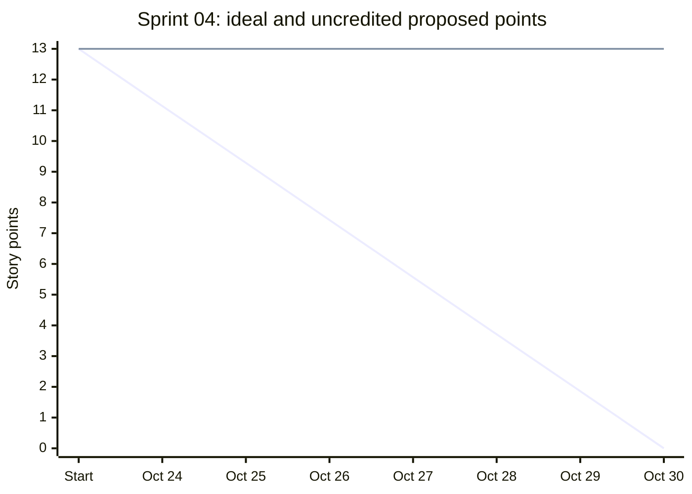

# Sprint 04 Burndown

Project: **Ustaad.af - Digital Marketplace for Skilled Workers**

Dates: **October 24-30, 2026** (7 scheduled calendar workdays)

Sprint goal: Verify administration, integrate workflows, refine UX, finalize models and prepare submission evidence.

## Baseline and evidence basis

The [sprint backlog](../06-sprints/sprint-04/sprint-backlog.md) proposes **13 story points**. The [planning record](../07-meetings/sprint-planning/2026-10-24-sprint-planning.md) retains the proposal without establishing individual availability or a final capacity-backed commitment. **Final committed total is not established in the project records.** The proposed total supplies the chart baseline.

Daily records describe intended checks and scripted actions, not measured end-of-day balances. The [review record](../07-meetings/sprint-review/2026-10-30-sprint-review.md) leaves all five stories pending verification and records no accepted story. Therefore **0 points are credited as Done and 13 proposed points remain uncredited** in this reconciliation. This records documented acceptance; it does not claim that no work occurred.

## Story-point reconciliation

| Story | Proposed scope | Proposed points | Credited Done points | Uncredited points |
| --- | --- | ---: | ---: | ---: |
| US-16 | inspect and suspend or restore users | 3 | 0 | 3 |
| US-17 | inspect and cancel inappropriate jobs | 3 | 0 | 3 |
| US-18 | manage skill categories | 2 | 0 | 2 |
| US-19 | resolve reports and hide or restore reviews | 3 | 0 | 3 |
| US-20 | send a contact enquiry | 2 | 0 | 2 |
| **Total** | **Five stories pending verification** | **13** | **0** | **13** |

Credit requires the [Definition of Done](../06-sprints/sprint-04/definition-of-done.md), including supporting verification and Bahara Noorzai's acceptance. Existing implementation, test-file presence, planned checks and partial functionality do not earn story points. Sahar Haidary owns technical evidence; Bahara owns acceptance; Ahmad maintains progress records.

## Daily burndown

Start-of-sprint ideal: **13 points**. For scheduled day d, ideal remaining = max(0, 13 * (1 - d / 7)), rounded to two decimals. All scheduled dates count, including weekends, matching the daily sprint schedule.

Uncredited proposed points = 13 minus documented accepted points. This reconstructed balance stays at 13 because the sources supply no dated Done decision. **Actual daily remaining-effort measurements are absent.** These balances must not be labeled measured actuals. Each date links to its stand-up; the final date also uses the review cited above.

| Date | Ideal remaining points | Uncredited proposed points | Recorded focus and evidence status |
| --- | ---: | ---: | --- |
| [2026-10-24](../07-meetings/daily-standups/2026-10-24-daily-standup.md) | 11.14 | 13 | Retain administration/contact scope alongside earlier unresolved work; protect integration time. |
| [2026-10-25](../07-meetings/daily-standups/2026-10-25-daily-standup.md) | 9.29 | 13 | Plan administration and contact checks; mail configuration is a dependency, with no delivery result supplied. |
| [2026-10-26](../07-meetings/daily-standups/2026-10-26-daily-standup.md) | 7.43 | 13 | Check non-admin access, referenced categories, cancellation, contact throttling and safe mail failure. |
| [2026-10-27](../07-meetings/daily-standups/2026-10-27-daily-standup.md) | 5.57 | 13 | Separate product defects, missing measurements and submission-evidence gaps. |
| [2026-10-28](../07-meetings/daily-standups/2026-10-28-daily-standup.md) | 3.71 | 13 | Plan the post-to-review journey and 360/1280-pixel checks; no measurements or passing results are supplied. |
| [2026-10-29](../07-meetings/daily-standups/2026-10-29-daily-standup.md) | 1.86 | 13 | Reconcile stories, UML and process documents; document existence does not establish verification. |
| [2026-10-30](../07-meetings/daily-standups/2026-10-30-daily-standup.md) | 0.00 | 13 | Scripted review retains all five stories pending verification; integration, build and quality evidence remain incomplete. |

## Burndown chart

First line: ideal remaining points. Second line: uncredited proposed points reconstructed from the records. Start is the baseline before the first workday. The table above provides the same data when Mermaid is unavailable.

## Interpretation and close-out

The ideal reaches **0** on October 30; the acceptance reconciliation ends at **13 uncredited points**, a **13-point gap** against the proposed ideal. This identifies unresolved verification and acceptance. It does not establish 13 points of coding left or prove software failure. Actual velocity and commitment completion rate cannot be established without confirmed commitment and dated acceptance evidence.

No quantified scope addition, removal or re-estimation is recorded in the sources used here. The original proposed baseline is preserved. Earlier unresolved work remains a dependency and prioritization concern; it is not silently added to this sprint total or counted twice. Documentation, UML, integration and meeting tasks have no separate point allocation in this baseline.

Reconcile administration/contact and earlier unresolved scope during October 31 preparation. Bahara owns product priorities and acceptance, Sahar owns technical evidence and models, and Ahmad owns process records and submission preparation. October 31 is outside this sprint chart.

Any later correction requires dated story acceptance or a scope decision and a linked source. Preserve this baseline and the original daily record when recording that revision.
